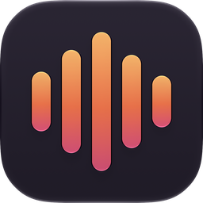
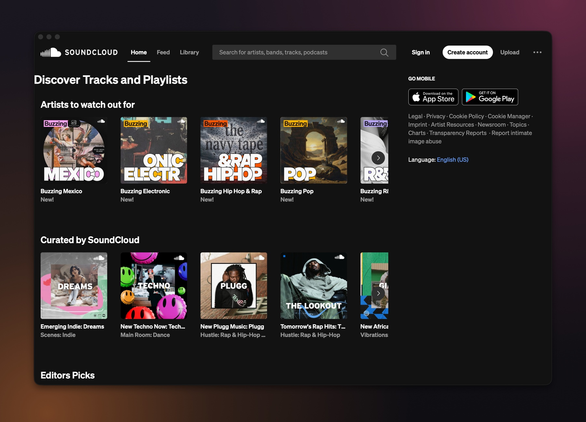
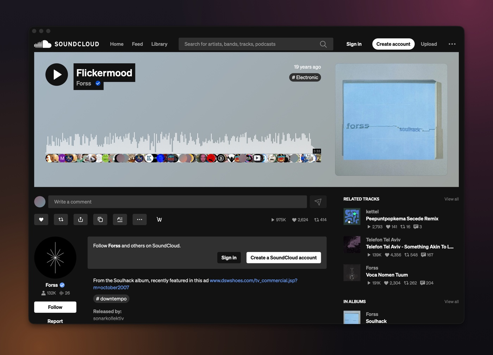
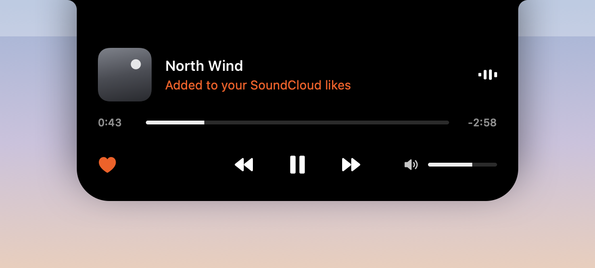

<p align="center">
  
</p>

<h1 align="center">Wisp</h1>

<p align="center">
  SoundCloud for the Mac, in a window of its own.
</p>

<p align="center">
  <a href="https://github.com/rbnmssno/Wisp/releases/latest"></a>
  
  <a href="https://github.com/rbnmssno/Wisp/actions/workflows/build.yml"></a>
  <a href="LICENSE"></a>
</p>

<p align="center">
  <a href="https://github.com/rbnmssno/Wisp/releases/latest/download/Wisp.dmg"><b>Download Wisp.dmg</b></a>
  &nbsp;·&nbsp;
  <a href="#по-русски">Русская версия</a>
</p>



SoundCloud has no desktop app, and a browser tab gets lost among the others. Wisp opens soundcloud.com in a window of its own, with SoundCloud's dark theme, the Mac's media keys, Control Center and AirPods. Audio ads are blocked. A free SoundCloud account is enough.

| A track page | On the notch, with Monobrow |
|---|---|
|  |  |

## Download

[Wisp.dmg](https://github.com/rbnmssno/Wisp/releases/latest/download/Wisp.dmg) for macOS 14 or later on Apple silicon.

The first launch needs to be allowed by hand once:

1. Open the disk image and drag Wisp to Applications.
2. Open Wisp. macOS refuses to run it; click Done.
3. Go to System Settings → Privacy & Security, scroll down and click Open Anyway next to the Wisp message.

Instead of steps 2 and 3 you can clear the quarantine flag in Terminal:

```
xattr -dr com.apple.quarantine /Applications/Wisp.app
```

## Features

- The real soundcloud.com: your account, likes, playlists and uploads. Sign in with email, Google or Apple
- SoundCloud's own dark theme
- Media keys, AirPods and Control Center play, pause, skip and seek
- Closing the window keeps the music playing; the Dock icon brings it back
- Opens on the page where you left off
- Blocks audio ads, ad slots, promoted tracks and upsell banners (Wisp → Block Ads turns it off)
- Shows what plays on the MacBook notch together with [Monobrow](https://github.com/rbnmssno/Monobrow), likes included
- English or Russian menus, following the system language

## Shortcuts

| Keys | Action |
|---|---|
| Space | Play / pause (on the page) |
| ⌘→ / ⌘← | Next / previous track |
| ⌘↑ / ⌘↓ | Volume up / down |
| ⌘L | Like |
| ⌘⇧L | Show the current track |
| ⌘F | Search |
| ⌘[ / ⌘] | Back / forward |
| ⌘⇧H | Home |
| ⌘R | Reload |
| ⌘+ / ⌘− / ⌘0 | Zoom in / out / actual size |
| ⌘W | Close the window (the music keeps playing) |

## How it works

The window is a WebKit view with its own persistent storage, so the sign-in stays between launches. It presents itself as the Safari installed on the Mac, so Google sign-in accepts it. Sign-in pop-ups open as small windows; links to other sites open in your browser.

A small script on the page reads what plays from the Media Session the site fills for browsers, from the events of its audio element and from the player bar. Nothing is polled: a change sends one short report to the app. Commands press the site's own buttons, so the page always agrees with what you see elsewhere.

Control Center, media keys and AirPods use WebKit's own Now Playing, filled from the page's Media Session. Play, pause and seek from the system go through the site's buttons as well.

Ad blocking uses WebKit's content blocker, the engine behind Safari's ad blockers. Before each track the player asks `api-v2.soundcloud.com/audio-ads` whether to play an ad; that request is blocked, so no ad reaches the player. The rules follow EasyList, uBlock Origin and AdGuard. Sign-in, the site's bot check and the cookie dialog are left alone.

Monobrow learns what plays from a distributed notification, `app.wisp.Wisp.PlaybackStateChanged`, with the same keys Spotify uses, and sends its buttons back on `app.wisp.Wisp.Command`.

Measured with `footprint` and `top` on an Apple silicon MacBook Pro:

| | Memory | CPU |
|---|---|---|
| Window hidden, nothing playing | ~300 MB | ~0% |
| Playing | ~300 MB | ~2% |

About 235 MB of that is the SoundCloud page itself, as in a browser tab. The app's own process takes 26 MB.

## Privacy

Wisp collects nothing and talks to no server of its own. What the site stores, like the sign-in, stays in the app's WebKit storage on your Mac.

## Building

You need Xcode or the Command Line Tools with Swift 5.9 or later.

```
scripts/build.sh
```

This makes `dist/Wisp.app` and `dist/Wisp.dmg`. A copy you build yourself opens without the Gatekeeper step. `scripts/make-signing-identity.sh` creates a local signing certificate in the project folder, so every build keeps the same identity on your Mac.

The icon is an Icon Composer file, `Resources/AppIcon.icon`, compiled by Xcode 26 or later. Release disk images are built by GitHub Actions from the tagged source.

Development switches, none of which touch your own Wisp, sign-in or settings:

```
Wisp --isolated --log             # a test copy beside your Wisp, with its own website data and settings
Wisp --isolated --ephemeral       # the same, with website data that is thrown away on quit
Wisp --mute                       # plays at volume 0
Wisp --url URL                    # opens a page after a few seconds (--url-at)
Wisp --command-at "20:pause,25:next,30:seek=60"
Wisp --probe file.js --probe-at 8,12      # runs a script on the page and prints what it returns
Wisp --now-playing-at 20          # prints what WebKit hands to Now Playing
Wisp --snapshot out.png           # a picture of the page (--snapshot-at)
Wisp --ads                        # ad blocking off for this run
Wisp --quit-after 60
```

The binary is `dist/Wisp.app/Contents/MacOS/Wisp`.

| File | What's there |
|---|---|
| `Sources/Wisp/PlayerWindow.swift` | The window, the web view, sign-in pop-ups, the page to come back to |
| `Resources/bridge.js` | The page script: what plays, and the commands |
| `Sources/Wisp/AdBlock.swift` | The ad blocking rules |
| `Sources/Wisp/MonobrowLink.swift` | The link to Monobrow |
| `Sources/Wisp/AppDelegate.swift` | Menus and shortcuts |
| `Sources/Wisp/DevProbe.swift` | The development switches |

## Uninstalling

Delete the app. Its data is in `~/Library/WebKit/app.wisp.Wisp`, `~/Library/HTTPStorages/app.wisp.Wisp*`, `~/Library/Caches/app.wisp.Wisp` and `~/Library/Preferences/app.wisp.Wisp.plist`.

## По-русски

Wisp — приложение SoundCloud для Mac. У SoundCloud нет приложения для компьютера, а вкладка в браузере теряется среди остальных. Wisp открывает soundcloud.com в своём окне, с тёмной темой самого SoundCloud, медиаклавишами, Пунктом управления и AirPods. Аудиореклама блокируется. Хватит бесплатного аккаунта SoundCloud.

### Установка

[Скачать Wisp.dmg](https://github.com/rbnmssno/Wisp/releases/latest/download/Wisp.dmg). Нужна macOS 14 или новее на Apple silicon.

Первый запуск нужно один раз разрешить вручную:

1. Открой образ и перетащи Wisp в «Программы».
2. Запусти Wisp. macOS откажется его открывать, нажми «Готово».
3. Открой «Системные настройки» → «Конфиденциальность и безопасность», прокрути вниз и нажми «Всё равно открыть» рядом с сообщением о Wisp.

Вместо шагов 2 и 3 можно снять карантин в Терминале:

```
xattr -dr com.apple.quarantine /Applications/Wisp.app
```

### Что умеет

- Настоящий soundcloud.com: твой аккаунт, лайки, плейлисты и загрузки. Вход по почте, через Google или Apple
- Тёмная тема самого SoundCloud
- Медиаклавиши, AirPods и Пункт управления ставят на паузу, переключают и перематывают
- Если закрыть окно, музыка продолжит играть, а иконка в Dock вернёт окно
- Открывается на той странице, где ты остановился
- Блокирует аудиорекламу, рекламные места, продвигаемые треки и баннеры с предложением подписки (выключается в меню Wisp → «Блокировать рекламу»)
- Вместе с [Monobrow](https://github.com/rbnmssno/Monobrow) показывает, что играет, в вырезе MacBook, и лайкает оттуда же
- Меню на русском или английском, по языку системы

Горячие клавиши, устройство, сборка и удаление описаны выше в английской части.

---

Wisp is a personal project, not affiliated with SoundCloud. SoundCloud is a trademark of SoundCloud Global Limited & Co. KG. [MIT license](LICENSE).
